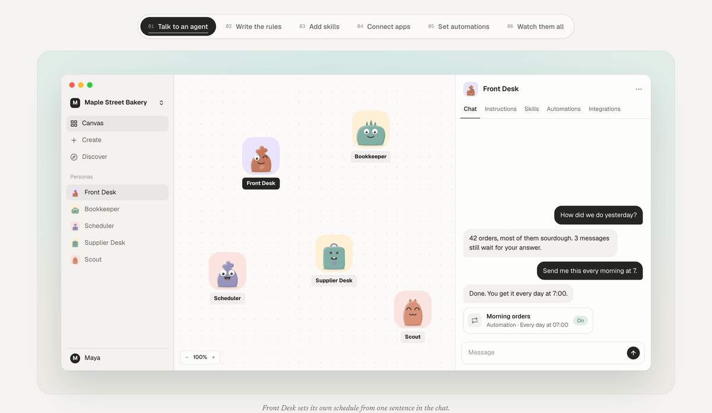

<p align="center">
  <a href="https://usepersona.dev"></a>
</p>

<h1 align="center">Persona</h1>

<p align="center">
  The agent factory. Make AI agents with your rules, skills and apps, and put them on WhatsApp, Telegram and the web.
</p>

<p align="center">
  <a href="https://usepersona.dev">Website</a> ·
  <a href="https://docs.usepersona.dev">Docs</a> ·
  <a href="https://docs.usepersona.dev/api">API</a> ·
  <a href="https://docs.usepersona.dev/open-source/development#deploy">Deploy guide</a>
</p>

<p align="center">
  <a href="https://github.com/usepersona-dev/persona/stargazers"></a>
  <a href="https://github.com/usepersona-dev/persona/network/members"></a>
  <a href="https://github.com/usepersona-dev/persona/graphs/contributors"></a>
  <a href="https://github.com/usepersona-dev/persona/commits/main"></a>
  <a href="https://github.com/usepersona-dev/persona/issues"></a>
  <a href="LICENSE"></a>
</p>

<p align="center">
  If Persona is useful to you, give it a ⭐ on GitHub. It helps other people find it.
</p>

<p align="center">
  
</p>

## Features

- **WhatsApp, Telegram and web chat**, with a chat of their own for each person.
- **Your voice and your rules:** instructions, skills, and a choice of models on the Vercel AI Gateway.
- **Memory** for each persona, and notes it keeps by itself.
- **Real work:** apps such as Gmail and Calendar, MCP servers, a vault for logins, a browser and a sandbox.
- **Runs on its own:** schedules, webhooks and app triggers, and it tells the person what came of them.
- **Files and pages:** images, video and voice notes, and pages published on each persona's own address.
- **Credits and billing** with Autumn and Stripe, and an API for everything the app does.

## What's in this repo

- [apps/web](apps/web): the app and the agent.
- [apps/docs](apps/docs): the docs site, [docs.usepersona.dev](https://docs.usepersona.dev).
- [apps/landing](apps/landing): the landing page, [usepersona.dev](https://usepersona.dev).
- [apps/files](apps/files): the files Worker, which serves published files and pictures, on Cloudflare or with Node.

Each app is a project of its own, in one pnpm workspace: run `pnpm install` once, anywhere in the repo. `pnpm dev` at the root starts the app, the docs and the landing; in an app's folder, it starts that app.

## Quick start

You need Node 24, pnpm, Postgres 15 or later, Redis 6 or later, Docker, and an account with each service in [What you need](https://docs.usepersona.dev/open-source/development#what-you-need). Persona needs all of them to run.

```bash
git clone https://github.com/usepersona-dev/persona.git
cd persona/apps/web
pnpm install
cp .env.example .env.local   # fill in your keys
pnpm db:migrate              # the tables; safe to run again
pnpm autumn:push             # the plans in Autumn; safe to run again
pnpm dev                     # http://localhost:3000
```

## Deploy

[](https://vercel.com/new/clone?repository-url=https%3A%2F%2Fgithub.com%2Fusepersona-dev%2Fpersona&project-name=persona&repository-name=persona&demo-title=Read%20the%20deployment%20guide%20first&demo-description=Persona%20needs%20a%20Vercel%20Pro%20team%2C%20a%20Postgres%20database%2C%20a%20Redis%2C%20and%20accounts%20for%20Clerk%2C%20Autumn%2C%20Supermemory%2C%20Composio%20and%20Cloudflare.%20The%20guide%20shows%20each%20step.&demo-url=https%3A%2F%2Fdocs.usepersona.dev%2Fopen-source%2Fdevelopment%23deploy&demo-image=https%3A%2F%2Fraw.githubusercontent.com%2Fusepersona-dev%2Fpersona%2Fmain%2F.github%2Fassets%2Fbanner.jpg&env=APP_URL%2CNEXT_PUBLIC_SITE_URL%2CDATABASE_URL%2CREDIS_URL%2CNEXT_PUBLIC_CLERK_PUBLISHABLE_KEY%2CCLERK_SECRET_KEY%2CNEXT_PUBLIC_CLERK_SIGN_IN_URL%2CNEXT_PUBLIC_CLERK_SIGN_UP_URL%2CNEXT_PUBLIC_CLERK_SIGN_IN_FALLBACK_REDIRECT_URL%2CNEXT_PUBLIC_CLERK_SIGN_UP_FALLBACK_REDIRECT_URL%2CAUTUMN_SECRET_KEY%2CAGENT_TOKEN_SECRET%2CSECRETS_KEY%2CAUTOMATIONS_SECRET%2CSUPERMEMORY_API_KEY%2CCOMPOSIO_API_KEY%2CCOMPOSIO_WEBHOOK_SECRET%2CS3_ENDPOINT%2CS3_REGION%2CS3_ACCESS_KEY_ID%2CS3_SECRET_ACCESS_KEY%2CS3_FILES_BUCKET%2CFILES_PREVIEW_URL%2CPUBLISHED_FILES_DOMAIN&envDefaults=%7B%22NEXT_PUBLIC_CLERK_SIGN_IN_URL%22%3A%22%2Fsign-in%22%2C%22NEXT_PUBLIC_CLERK_SIGN_UP_URL%22%3A%22%2Fsign-up%22%2C%22NEXT_PUBLIC_CLERK_SIGN_IN_FALLBACK_REDIRECT_URL%22%3A%22%2F%22%2C%22NEXT_PUBLIC_CLERK_SIGN_UP_FALLBACK_REDIRECT_URL%22%3A%22%2F%22%7D&envDescription=Persona%20needs%20each%20of%20these%20to%20run.%20Read%20the%20deployment%20guide%20first%3B%20the%20Environment%20section%20says%20where%20each%20one%20comes%20from.&envLink=https%3A%2F%2Fdocs.usepersona.dev%2Fopen-source%2Fdevelopment%23environment)

How to make it work:

1. **Use a Vercel Pro team.** The agent's schedule runs every minute; on Hobby, schedules run once a day.
2. **Have a Postgres, a Redis and the accounts in [What you need](https://docs.usepersona.dev/open-source/development#what-you-need).** No Postgres or Redis yet? The Vercel Marketplace has both, Neon and Upstash. For Neon, use the direct address (Neon calls it unpooled). Set up Clerk as [Clerk](https://docs.usepersona.dev/open-source/development#clerk) says: organizations on.
3. **Click the button.** Vercel copies the repository into a new one of yours. On the configure screen, set **Root Directory** to `apps/web`: the copy keeps our lockfile, so Vercel installs with pnpm, as our own builds do. Then fill in the settings; the [Environment](https://docs.usepersona.dev/open-source/development#environment) table says where each one comes from. For `APP_URL`, write the address the project will get, usually `https://<project name>.vercel.app`, and change it after the first deploy if Vercel gives another. If you miss the Root Directory, the first build fails: set it in the project's **Settings → Build and Deployment**, then redeploy.
4. **Deploy.** The first build makes the tables and pushes the plans to Autumn.
5. **Then, if you want them:** the files Worker for published files ([apps/files](apps/files)), and a WhatsApp number or Telegram bot of your own ([Channel webhooks](https://docs.usepersona.dev/open-source/development#channel-webhooks)).

The button's copy is a new repository, not a fork. To pull our updates later, fork the repository instead and import it in Vercel the same way: **New Project → Import → Root Directory `apps/web`**. That is how our own projects build. The [deployment guide](https://docs.usepersona.dev/open-source/development#deploy) has every step.

## Built with

[Next.js](https://nextjs.org) · [eve](https://eve.dev) · [Prisma](https://www.prisma.io) · [Clerk](https://clerk.com) · [Vercel AI Gateway](https://vercel.com/ai-gateway) · [Supermemory](https://supermemory.ai) · [Composio](https://composio.dev) · [Browser Use](https://browser-use.com) · [Autumn](https://useautumn.com) · [Cloudflare R2](https://www.cloudflare.com/developer-platform/products/r2/)

## Docs

- [Quickstart](https://docs.usepersona.dev/quickstart): a persona, a chat and an automation through the API.
- [Architecture](https://docs.usepersona.dev/open-source/architecture): how a turn runs, and what is stored where.
- [Development](https://docs.usepersona.dev/open-source/development): every setting, the database, and deploying.
- [API](https://docs.usepersona.dev/api): every endpoint.

## Contributing

Read [CONTRIBUTING.md](CONTRIBUTING.md) to set up and send a change. Found a security issue? Read [SECURITY.md](SECURITY.md) and write to us first.

<a href="https://github.com/usepersona-dev/persona/graphs/contributors">
  
</a>

## Star history

<a href="https://www.star-history.com/#usepersona-dev/persona&Date">
  <picture>
    <source media="(prefers-color-scheme: dark)" srcset="https://api.star-history.com/svg?repos=usepersona-dev/persona&type=Date&theme=dark">
    
  </picture>
</a>

## License

[AGPL-3.0-only](LICENSE) © 2026 Odinex, Inc.

Persona and the Persona logo are trademarks of Odinex, Inc. The license covers the code. It gives no right to use the name or the logo.
